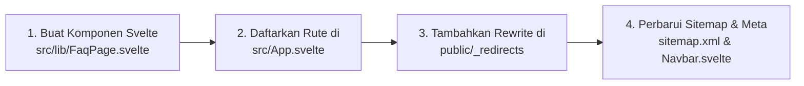
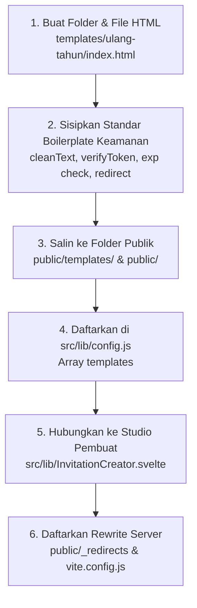

# Master Report: Rekap Sistem, Pengujian, Panduan Developer & Checklist Deploy
**Proyek:** Priyanivedana — Web Undangan Digital (*warta.guskhamim.com*)  
**Pembaruan Terakhir:** 14 Oktober 2026  
**Status Build Produksi:** `PASS` (Vite v6.4.4 selesai dalam 1.27 detik, 0 error)

---

## 1. Rekap: Apa Saja yang Sudah Kita Bangun

Seluruh platform Priyanivedana telah berevolusi menjadi web aplikasi undangan digital yang lengkap, responsif, aman, dan siap pakai:

### A. Landing Page & Desain Sistem
- **GusKhamim UI System**: Menggunakan estetika *tactile claymorphism* dengan latar lembut ice-blue (`#EEF4FB`), kartu putih melayang bersudut 22–24px, tipografi Inter yang bersih, dan tombol aksen koral (`#F45B69`).
- **Navbar & Breadcrumb Pintar**: Menghilangkan garis bawah tautan yang mengganggu, navigasi mulus antar section, dan mempertahankan state scroll.
- **Section Lengkap**: Hero interaktif, Filosofi Warta, Showroom 4 Pilihan Template dengan thumbnail mobile, Daftar Harga (Paket Gratis & Resmi), dan Footer informatif.

### B. Studio Pembuat Undangan ([InvitationCreator.svelte](file:///home/khamim/project/personal/warta.guskhamim.com/src/lib/InvitationCreator.svelte))
- **Form 4 Langkah**: Pemilihan jenis acara, pengisian data (nama, tanggal, tempat), daftar tamu, dan hasil tautan siap kirim.
- **Fitur Tempel Massal (*Bulk Paste*)**: Memasukkan daftar tamu sekaligus dalam format `Nama, No. WA` dengan batas aman otomatis.
- **Generator Tautan & Pesan WhatsApp**: Otomatis membuat teks undangan siap kirim ke WhatsApp dengan tautan personal masing-masing tamu.
- **Penyimpanan Draft**: Auto-save data formulir ke `localStorage` agar data pengguna tidak hilang saat halaman tertutup.

### C. Empat Template Undangan Siap Pakai
1. **Pernikahan (Nikah)**: Ornamen floral klasik, cover buka undangan, countdown acara, dan tipografi romantis.
2. **Lamaran**: Nuansa pastel elegan, box cincin dan informasi keluarga kedua mempelai.
3. **Acara Kantor (Halal Bihalal)**: Nuansa korporat biru navy-emas modern, efek letusan konfeti meriah, dan ornamen Ramadhan yang proporsional.
4. **Walimatul Khitan**: Nuansa sage green dan soft gold, bingkai foto anak melingkar emas, doa walimah khitan, dan integrasi peta lokasi.

### D. Sistem Keamanan & Halaman Khusus
- **Masa Aktif 3 Hari**: Penegakan batas kedaluwarsa gratis dengan layar penawaran perpanjangan resmi Rp25.000.
- **Halaman [Tamu Tidak Terdaftar](file:///home/khamim/project/personal/warta.guskhamim.com/public/tamu-tidak-terdaftar.html)**: Halaman mandiri ramah tanpa badge berlebihan dan dilengkapi tombol tunggal *Kembali ke Halaman Beranda*.
- **Halaman Fallback [404.html](file:///home/khamim/project/personal/warta.guskhamim.com/public/404.html) & [500.html](file:///home/khamim/project/personal/warta.guskhamim.com/public/500.html)**: Menangani tautan rusak dengan navigasi terarah.

---

## 2. Hasil Pengujian Fungsional & Matriks Status (Test Matrix)

| Modul / Skenario | Kondisi Uji | Hasil yang Diharapkan | Status |
| :--- | :--- | :--- | :--- |
| **Masa Aktif Tautan** | Dibuat baru dari generator (`now < exp`) | Undangan terbuka normal, nama tamu sesuai | **LULUS** |
| **Pencegahan Tautan Expired** | Parameter `exp` diubah ke masa lalu di URL | Layar terkunci, muncul paywall perpanjangan Rp25.000 | **LULUS** |
| **Manipulasi Nama Tamu** | `to=` diubah tanpa token hash `k` yang cocok | Layar dibersihkan dan otomatis dialihkan ke `/tamu-tidak-terdaftar` | **LULUS** |
| **Layar Tamu Tidak Terdaftar** | Akses langsung `/tamu-tidak-terdaftar` | Tampil pesan sopan, tanpa badge pengganggu, tombol ke beranda aktif | **LULUS** |
| **Sanitasi Anti-XSS** | Karakter berbahaya (`<script>`, backtick, `{}`) di URL | Dibersihkan oleh `cleanText()`, teks dimasukkan via `.textContent` | **LULUS** |
| **Pencegahan DoS Input** | Teks panjang pada input nama, lokasi, textarea | Dibatasi oleh atribut `maxlength` dan pemotongan slice di JavaScript | **LULUS** |
| **Batas Tamu Gratis** | Menambahkan lebih dari 10 tamu | Dicegat maksimal 10 tamu (`slice(0, 10)`), muncul alert batas gratis | **LULUS** |
| **Routing SPA & Navigasi** | Akses langsung ke `/coba-gratis`, `/404`, atau tombol kembali | Bekerja lancar tanpa broken link atau infinite reload | **LULUS** |
| **Produksi Build Vite** | Menjalankan `npm run build` | Bundel statis `dist/` terbentuk dalam ~1.27 detik tanpa error | **LULUS** |

---

## 3. Apa Saja yang Perlu di-Improve ke Depan (Roadmap)

Meskipun sistem saat ini sudah sangat stabil dan siap deploy, berikut adalah poin-poin peningkatan yang direkomendasikan untuk pengembangan tahap berikutnya:

### 1. Serverless HMAC Secret Key (Peningkatan Keamanan Level Lanjut)
- **Kondisi Saat Ini**: Validasi token `k` menggunakan algoritma hashing djb2 di sisi klien (frontend). Cara ini sangat efisien untuk situs 100% statis tanpa server.
- **Rencana Peningkatan**: Jika ingin mencegah orang teknis yang paham JavaScript memalsukan token `k`, tambahkan Cloudflare Worker atau Vercel Serverless Function kecil untuk menandatangani token menggunakan `HMAC-SHA256` dengan kunci rahasia (*secret key*) yang hanya disimpan di server.

### 2. Fitur RSVP & Buku Tamu Interaktif (Konfirmasi Kehadiran)
- **Kondisi Saat Ini**: Tamu menerima dan membaca undangan.
- **Rencana Peningkatan**: Tambahkan form kehadiran tamu (Hadir / Tidak Hadir / Ragu-ragu) dan ucapan selamat yang langsung tersimpan ke Google Sheets (via Google Apps Script Webhook gratis) atau Supabase/Firebase tanpa perlu server backend berbayar.

### 3. Unggah Foto Pengguna Langsung dari Browser
- **Kondisi Saat Ini**: Foto pada template masih berupa preset bawaan (misal foto anak pada khitanan).
- **Rencana Peningkatan**: Integrasikan widget upload gambar gratis (seperti Cloudinary Widget atau ImgBB API) di studio pembuat undangan agar pengguna bisa mengunggah foto prewedding atau foto anak mereka sendiri.

### 4. Floating Audio Controller (Pemutar Musik)
- **Kondisi Saat Ini**: Musik berputar otomatis setelah tamu menekan tombol *Buka Undangan*.
- **Rencana Peningkatan**: Tambahkan tombol melayang (*floating play/pause music button*) di pojok layar template agar tamu dapat mematikan atau menyalakan kembali lagu latar sesuai kenyamanan mereka.

### 5. Kompresi Gambar Hero ke Format WebP
- **Kondisi Saat Ini**: File gambar [hero-illustration.png](file:///home/khamim/project/personal/warta.guskhamim.com/public/hero-illustration.png) berukuran ~733 KB.
- **Rencana Peningkatan**: Konversi ke `hero-illustration.webp` dengan kompresi kualitas 85% untuk memangkas ukuran menjadi ~90 KB guna mempercepat First Contentful Paint (FCP) di jaringan seluler.

---

## 4. Panduan Developer: Langkah Membuat Halaman Baru

Berikut adalah Standard Operating Procedure (SOP) jika Anda ingin menambahkan halaman baru ke dalam website (misalnya halaman `/faq` atau `/syarat-ketentuan`):



### Langkah demi Langkah:

#### Langkah 1: Buat Komponen Halaman Baru
Buat file baru di folder `src/lib/`, contoh: `src/lib/FaqPage.svelte`:
```svelte
<script>
  import Button from './Button.svelte';
  let { onNavigateHome = () => {} } = $props();
</script>

<svelte:head>
  <title>FAQ & Bantuan | Priyanivedana</title>
</svelte:head>

<main class="faq-page" style="padding: 40px 20px; max-width: 800px; margin: 0 auto;">
  <div class="clay-card" style="background:#fff; border-radius:24px; padding:32px;">
    <h1>Pertanyaan yang Sering Diajukan</h1>
    <p>Temukan jawaban seputar pembuatan dan perpanjangan undangan di Priyanivedana.</p>
    
    <!-- Konten FAQ -->
    
    <div style="margin-top:24px;">
      <Button variant="primary" href="/" onclick={(e) => { e.preventDefault(); onNavigateHome(); }}>
        Kembali ke Beranda
      </Button>
    </div>
  </div>
</main>
```

#### Langkah 2: Daftarkan Rute di `src/App.svelte`
Buka [src/App.svelte](file:///home/khamim/project/personal/warta.guskhamim.com/src/App.svelte):
1. Import komponen:
   ```javascript
   import FaqPage from './lib/FaqPage.svelte';
   ```
2. Tambahkan pengecekan path di fungsi `resolveRoute()`:
   ```javascript
   if (path === '/faq') {
     return 'faq';
   }
   ```
3. Tambahkan ke percabangan rendering template:
   ```svelte
   {:else if currentRoute === 'faq'}
     <FaqPage onNavigateHome={(hash) => navigateTo('home', hash)} />
   ```

#### Langkah 3: Tambahkan Aturan Redirect di `public/_redirects`
Buka [public/_redirects](file:///home/khamim/project/personal/warta.guskhamim.com/public/_redirects) dan tambahkan rute baru agar saat di-refresh tidak menghasilkan 404:
```
/faq    /index.html    200
```

#### Langkah 4: Daftarkan di Sitemap
Buka [public/sitemap.xml](file:///home/khamim/project/personal/warta.guskhamim.com/public/sitemap.xml) dan tambahkan entri URL baru:
```xml
  <url>
    <loc>https://warta.guskhamim.com/faq</loc>
    <changefreq>monthly</changefreq>
    <priority>0.8</priority>
  </url>
```

---

## 5. Panduan Developer: Langkah Menyiapkan Template Baru

Contoh studi kasus: Menambahkan template ke-5, yaitu **"Ulang Tahun / Milad"** (`id: 'ulang-tahun'`).



### Langkah demi Langkah:

#### Langkah 1: Buat Direktori Template
Buat folder baru:
- `templates/ulang-tahun/`
- `public/templates/ulang-tahun/`
- `public/ulang-tahun/`

#### Langkah 2: Buat File `index.html` dengan Boilerplate Keamanan Standar
Buat file `templates/ulang-tahun/index.html` dan pastikan memuat script standar penanganan token & kedaluwarsa berikut:

```html
<!DOCTYPE html>
<html lang="id">
<head>
  <meta charset="UTF-8">
  <meta name="viewport" content="width=device-width, initial-scale=1.0">
  <title>Undangan Ulang Tahun</title>
  <style>
    /* Styling tema ulang tahun */
  </style>
</head>
<body>
  <div id="cover">
    <p>Kepada Yth. <b class="guest-name">Nama Tamu</b></p>
    <h1 id="event-title">Ulang Tahun</h1>
    <button id="btn-open">Buka Undangan</button>
  </div>

  <div id="main-content">
    <h2 id="child-name">Nama Pengantin / Yang Berulang Tahun</h2>
    <p id="event-date">Hari, Tanggal</p>
    <p id="event-location">Lokasi Acara</p>
  </div>

  <script>
    // 1. Algoritma Verifikasi Token
    function verifyToken(text, exp, key) {
      if (!text || !key) return false;
      let hash = 5381;
      const str = `${text.trim().toLowerCase()}_${exp || ''}`;
      for (let i = 0; i < str.length; i++) {
        hash = ((hash << 5) + hash) + str.charCodeAt(i);
        hash = hash & 0xffffffff;
      }
      return Math.abs(hash).toString(36) === key;
    }

    // 2. Fungsi Sanitasi Input Anti-XSS
    function cleanText(str) {
      return (str || '').replace(/[<>"'/\\{}`]/g, '').trim().slice(0, 60);
    }

    // 3. Baca Parameter URL
    const params = new URLSearchParams(window.location.search);
    const rawTo = params.get('to');
    const rawExp = params.get('exp');
    const key = params.get('k');
    const p = params.get('p');
    const d = params.get('d');
    const loc = params.get('loc');

    // 4. Penegakan Masa Aktif 3 Hari (Hanya dipicu jika waktu lewat)
    if (rawExp) {
      const expTimestamp = parseInt(rawExp, 10);
      const now = Math.floor(Date.now() / 1000);
      if (expTimestamp && !isNaN(expTimestamp) && now > expTimestamp) {
        document.body.innerHTML = `
          <div style="min-height:100dvh;display:grid;place-items:center;padding:24px;text-align:center;font-family:sans-serif;">
            <div style="background:#fff;max-width:440px;padding:32px;border-radius:24px;box-shadow:0 10px 30px rgba(0,0,0,0.1);">
              <div style="font-size:3rem;margin-bottom:12px;">⏳</div>
              <h1 style="font-size:1.4rem;color:#333;">Masa Aktif Tautan Berakhir</h1>
              <p style="color:#666;font-size:0.95rem;margin-bottom:20px;">Tautan undangan gratis ini hanya aktif selama 3 hari.</p>
              <a href="https://wa.me/6281234567890?text=Halo%2C+saya+mau+aktifkan+link+resmi+Priyanivedana" style="display:inline-block;padding:12px 24px;background:#F45B69;color:#fff;text-decoration:none;border-radius:12px;font-weight:600;">
                Aktifkan Link Resmi (Rp25.000)
              </a>
            </div>
          </div>
        `;
        throw new Error('Masa aktif tautan telah berakhir.');
      }
    }

    // 5. Verifikasi Nama Tamu & Pengalihan jika Tidak Valid
    if (rawTo) {
      const isSignatureValid = (rawExp || key) ? verifyToken(rawTo, rawExp, key) : true;
      if (!isSignatureValid) {
        document.body.innerHTML = '';
        const targetUrl = window.location.protocol === 'file:' ? '../../tamu-tidak-terdaftar.html' : '/tamu-tidak-terdaftar';
        window.location.replace(targetUrl);
        throw new Error('Nama tamu tidak terdaftar.');
      }
      const safeGuest = cleanText(rawTo);
      document.querySelectorAll('.guest-name').forEach(el => el.textContent = safeGuest);
    }

    // 6. Terapkan Nilai Kustom Dinamis
    if (p) {
      const safeP = cleanText(p);
      const nameEl = document.getElementById('child-name');
      if (nameEl) nameEl.textContent = safeP;
    }
    if (d) {
      const safeD = cleanText(d);
      const dateEl = document.getElementById('event-date');
      if (dateEl) dateEl.textContent = safeD;
    }
    if (loc) {
      const safeLoc = cleanText(loc);
      const locEl = document.getElementById('event-location');
      if (locEl) locEl.textContent = safeLoc;
    }
  </script>
</body>
</html>
```

#### Langkah 3: Daftarkan di `src/lib/config.js`
Buka [src/lib/config.js](file:///home/khamim/project/personal/warta.guskhamim.com/src/lib/config.js) dan tambahkan ke array `templates`:
```javascript
export const templates = [
  // ... template yang sudah ada ...
  {
    id: 'ulang-tahun',
    name: 'Ulang Tahun & Milad',
    tag: 'Ulang Tahun',
    demoUrl: '/templates/ulang-tahun/',
    image: '/images/templates/template-ulang-tahun.png'
  }
];
```

#### Langkah 4: Hubungkan ke `src/lib/InvitationCreator.svelte`
Buka [src/lib/InvitationCreator.svelte](file:///home/khamim/project/personal/warta.guskhamim.com/src/lib/InvitationCreator.svelte):
1. Pada fungsi `selectTemplate(tplId)`:
   Tambahkan nilai default jika pengguna memilih template ini (misal nama anak yang berulang tahun, tanggal, dan lokasi perayaan).
2. Pada fungsi `getGuestUrl(guestName)`:
   Tambahkan mapping path:
   ```javascript
   if (formData.template === 'ulang-tahun') {
     templatePath = '/templates/ulang-tahun/';
   }
   ```

#### Langkah 5: Sinkronkan File dan Daftarkan Server Rewrite
1. Salin template ke folder publik:
   ```bash
   cp templates/ulang-tahun/index.html public/templates/ulang-tahun/index.html
   cp templates/ulang-tahun/index.html public/ulang-tahun/index.html
   ```
2. Tambahkan rewrite di [public/_redirects](file:///home/khamim/project/personal/warta.guskhamim.com/public/_redirects):
   ```
   /templates/ulang-tahun/*  /templates/ulang-tahun/index.html  200
   /ulang-tahun/*            /ulang-tahun/index.html            200
   ```
3. Tambahkan ke `templateMatches` di [vite.config.js](file:///home/khamim/project/personal/warta.guskhamim.com/vite.config.js):
   ```javascript
   const templateMatches = ['nikah', 'lamaran', 'kantor', 'khitan', 'ulang-tahun'];
   ```

---

## 6. Checklist Persiapan Deploy Produksi (Final Pre-Deployment)

Sebelum mempublikasikan website ke hosting produksi:

- [ ] **1. Ubah Nomor WhatsApp Admin**:
  Ganti nomor contoh `6281234567890` di [src/lib/config.js](file:///home/khamim/project/personal/warta.guskhamim.com/src/lib/config.js#L7) dan di semua file template dengan nomor WhatsApp resmi bisnis Anda.
- [ ] **2. Periksa Meta Tag Domain**:
  Pastikan canonical URL di [index.html](file:///home/khamim/project/personal/warta.guskhamim.com/index.html#L8) mengarah ke domain resmi (contoh: `https://warta.guskhamim.com/`).
- [ ] **3. Uji Build Produksi Lokal**:
  Jalankan perintah `npm run build` dan pastikan direktori `dist/` tercipta dengan file lengkap:
  `index.html`, `404.html`, `500.html`, `tamu-tidak-terdaftar.html`, `_redirects`, `_headers`, `robots.txt`, `sitemap.xml`, dan folder `templates/`.
- [ ] **4. Deploy ke Hosting**:
  - **Cloudflare Pages / Netlify**: Hubungkan Git, set Build command = `npm run build`, Output = `dist`.
  - **Nginx VPS**: Arahkan root web ke path `dist/` dan gunakan rewrite `try_files $uri $uri/ /index.html;`.
- [ ] **5. Pastikan SSL/HTTPS Aktif**:
  Fitur salin clipboard dan tautan WhatsApp bekerja optimal di lingkungan HTTPS.
